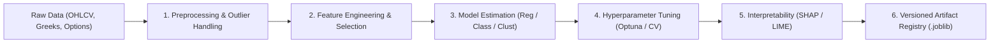

# ApxForge Quantitative Analytics — Machine Learning & AI Architecture

The ApxForge ML engine provides an end-to-end data science and machine learning infrastructure tailored for quantitative financial engineering, derivatives pricing, and return forecasting.

---

## 1. Pipeline Stages



### Stage 1: Preprocessing (`services/preprocessing.py`)
- **Missing Value Imputation**: Mean, Median, Mode, KNN Imputer, Forward/Backward Fill, Drop.
- **Outlier Treatment**: IQR bounding, Z-score clipping ($\pm 3\sigma$), and Winsorization (configurable 5th–95th percentiles).
- **Feature Scaling**: Standard Normalization ($z = \frac{x - \mu}{\sigma}$), Min-Max Scaling ($[0, 1]$), and RobustScaler (median and interquartile range to resist fat tails).

### Stage 2: Feature Engineering & Selection (`services/features.py`, `services/feature_selection.py`)
- **Feature Catalog**: Returns, log returns, multi-window rolling means and standard deviations (5, 20, 50, 200), historical realized volatility, RSI, MACD, Bollinger Bands, ATR, ADX, calendar features (day of week, month end), and autoregressive lag terms ($t-1, \dots, t-N$).
- **Selection Methods**:
  - Variance Threshold (removes quasi-constant predictors).
  - Mutual Information Regression / Classification (non-linear dependency capture).
  - L1 / Lasso Penalty (sparse coefficient shrinkage).
  - Recursive Feature Elimination (RFE) using Random Forest estimators.

### Stage 3: Supervised & Unsupervised Modeling (`services/predictor.py`, `services/clustering.py`, `services/dim_reduction.py`)
- **Regression**: Linear, Ridge, Lasso, ElasticNet, RandomForestRegressor, GradientBoostingRegressor, XGBRegressor, LightGBMRegressor.
- **Classification**: LogisticRegression, RandomForestClassifier, GradientBoostingClassifier, XGBClassifier.
- **Imbalanced Learning**: SMOTE (Synthetic Minority Over-sampling Technique) and ADASYN (Adaptive Synthetic) for directional classification with asymmetric market regimes.
- **Ensemble Meta-Learners**: VotingRegressor (weighted blend) and StackingRegressor (cross-validated out-of-fold meta-learner with Ridge meta-estimator).
- **Clustering**: KMeans (with automated elbow curve and silhouette scoring), DBSCAN (density-based spatial clustering for anomalous regime detection), and Agglomerative Hierarchical Clustering.
- **Dimensionality Reduction**: Principal Component Analysis (eigenvector loadings, explained variance ratio scree plot) and t-SNE for 2D/3D manifold embeddings.

### Stage 4: Time-Series & Deep Learning Fallback (`services/time_series.py`)
- **Statistical Stationarity**: Augmented Dickey-Fuller (ADF) test, Kwiatkowski-Phillips-Schmidt-Shin (KPSS) test.
- **Autocorrelation**: ACF and PACF series decomposition.
- **Forecasting**: Classical ARIMA / Auto-Regressive model and multi-layer perceptron (MLP) neural lag-window predictor with fallback from heavy TensorFlow/Keras libraries.

### Stage 5: Bayesian Hyperparameter Optimization (`services/tuning.py`)
- **Optuna Engine**: Tree-structured Parzen Estimator (TPE) algorithm with cross-validated pruning for learning rate, tree depth, subsample ratios, and regularization coefficients.
- **Grid & Randomized Search**: Exhaustive parameter sweep with parallel joblib execution.

### Stage 6: Interpretability & Explainability (`services/interpret.py`)
- **TreeSHAP**: Additive Shapley explanations decomposing individual predictions into baseline payoff + feature Shapley contributions.
- **LIME**: Local Interpretable Model-agnostic Explanations using sparse linear surrogates.
- **Permutation Importance**: Out-of-bag feature permutation to measure degradation in validation loss.

---

## 2. Model Registry & Persistence (`app/ml/`)

All trained model weights, scalers, feature column schemas, and validation metrics are tracked in `backend/app/ml/registry.py` and persisted to `backend/app/ml/artifacts/`:

1. **`options_pricing_rf_1.0.0.joblib`**: Random Forest Regressor trained on 2,000 synthetic Black-Scholes option pricing scenarios. Predicts options market value from moneyness, days to expiration, volatility, and underlying price.
2. **`directional_classifier_rf_1.0.0.joblib`**: Random Forest Classifier predicting next-session directional price movement (Up vs. Down) conditioned on momentum, volume, and returns.

To execute the autonomous retraining pipeline:
```bash
python -m backend.app.ml.train
```
